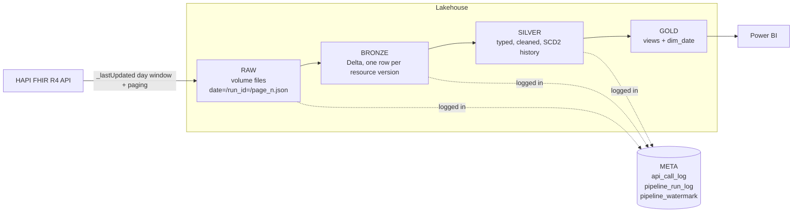
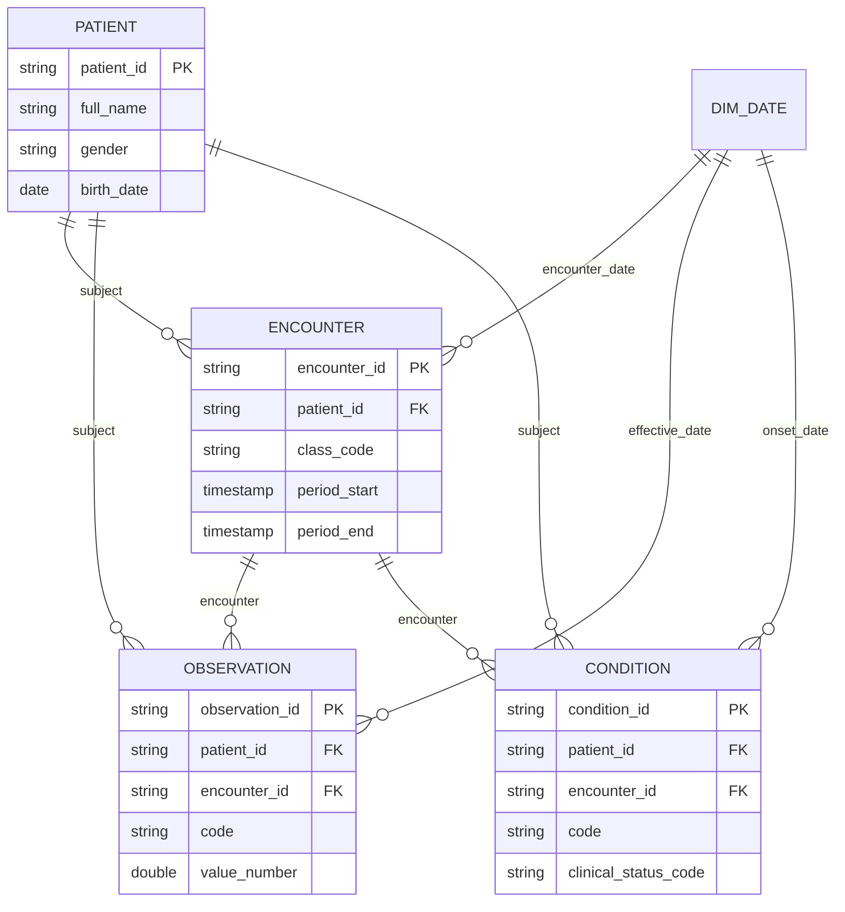

# Architecture

## Flow

## Layers

| Layer | Where | What is stored | Written by |
|-------|-------|----------------|-----------|
| Raw | volume `fhir_raw.raw_zone` | API pages untouched. Path: `<format>/<Resource>/date=YYYY-MM-DD/run_id=<id>/page_0001.json` | `raw_writer.py` via `ingest.py` |
| Bronze | `fhir_bronze.<resource>` | One row per resource version: original payload, JSON copy, hash, metadata | `bronze.py` |
| Silver | `fhir_silver.<resource>` | Flat typed columns, de-duplicated, SCD2 history | `silver.py`, `scd2.py` |
| Gold | `fhir_gold` views | Dimension, facts and summary views for reporting | `sql/gold_views.sql` |
| Meta | `fhir_meta` | Call log, run log, watermark | `audit.py` |

`date=` in the raw path is the day that was requested (the `_lastUpdated` day), so each resource has one folder per loaded day. A re-run adds a new `run_id=` folder and never overwrites older files.

## Metadata and versioning

| Question | Where to look |
|----------|---------------|
| When was each API call made? | `api_call_log.called_at` (one row per page, with the full request url and http status) |
| When was the data saved? | `api_call_log.saved_at`, and `bronze.bronze_loaded_at` for the Delta load |
| Which call produced a bronze row? | `bronze.api_url_or_params`, `extraction_timestamp`, `page_number`, `source_file` |
| Did a record change between loads? | Silver rows for the same id with different `version_number` / `valid_from`; `row_hash` differs |
| What happened in a run? | `pipeline_run_log` (layer, status, rows, message) |
| Where does the next load start? | `pipeline_watermark.watermark_ts` |

### Bronze columns

`resource_type, resource_id, version_id, last_updated, full_url, payload_format, resource_payload, resource_json, row_hash, api_url_or_params, extraction_timestamp, saved_at, page_number, source_file, run_id, ingest_date, bronze_loaded_at`

### SCD Type 2 in silver

Every silver table has these extra columns next to the business columns:

| Column | Meaning |
|--------|---------|
| `valid_from` | `meta.lastUpdated` of the version (falls back to extraction time) |
| `valid_to` | start of the next version, NULL while the version is current |
| `is_current` | true for the latest version |
| `version_number` | 1, 2, 3 ... per resource id |
| `row_hash` | SHA-256 over the business columns |
| `silver_loaded_at` | when the row was written |

On each load, for every incoming record (latest per id):

- id not in silver -> insert as version 1
- id exists and the hash differs and the record is newer -> close the current row (`valid_to`, `is_current = false`) and insert a new current row with `version_number + 1`, both in one MERGE
- same hash -> nothing happens
- older than what silver already holds -> ignored

## Table relationships

In FHIR the links are references such as `Patient/123`; silver extracts the id into `patient_id` / `encounter_id`.

## Gold objects

| Object | Type | Purpose |
|--------|------|---------|
| `dim_patient` | view | current patients with age and age group |
| `fact_encounter` | view | encounters with date, duration in minutes, class |
| `fact_observation` | view | observations with numeric value and unit |
| `fact_condition` | view | conditions with status, onset and recorded date |
| `dim_date` | table | calendar from the earliest fact date up to today |
| `vw_patient_summary` | view | encounters, observations, conditions per patient |
| `vw_daily_encounters` | view | encounters and patients per day and class |
| `vw_top_conditions` | view | most frequent conditions |
| `vw_vital_signs_summary` | view | average / min / max per vital sign |
| `vw_pipeline_audit` | view | run log |
| `vw_api_call_summary` | view | pages and resources per run and day |

Facts only read rows where `is_current` is true, so reports always show the latest version. History stays available in the silver tables.

## Data dictionary (silver)

**patient**: patient_id, active, identifier_system, identifier_value, given_name, family_name, full_name, gender, birth_date, birth_year, is_deceased, deceased_datetime, marital_status_code, marital_status_display, phone, email, address_city, address_state, address_postal_code, address_country, language_code

**encounter**: encounter_id, status, class_code, class_display, type_code, type_display, patient_id, period_start, period_end, reason_code, reason_display, service_provider_reference

**observation**: observation_id, status, category_code, code_system, code, code_display, patient_id, encounter_id, effective_ts, issued_ts, value_number, value_unit, value_text, interpretation_code, component_count

**condition**: condition_id, clinical_status_code, verification_status_code, category_code, code_system, code, code_display, severity_display, patient_id, encounter_id, onset_ts, abatement_ts, recorded_date

All silver tables also carry: source_version_id, source_last_updated, extraction_timestamp, source_run_id, effective_from, row_hash and the SCD2 columns above.

Cleaning rules: text is trimmed and empty strings become NULL, gender is lower-cased, dates and timestamps use safe casts (a bad value becomes NULL, it does not fail the job), references are reduced to ids, and arrays are read with safe element access.

## Known limits

- Only the fields listed above are modelled. Extra FHIR fields stay available in `resource_json` in bronze.
- Resources deleted on the server are not detected.
- XML pages are split on the driver (fine for demo-sized loads, not for very large ones).
